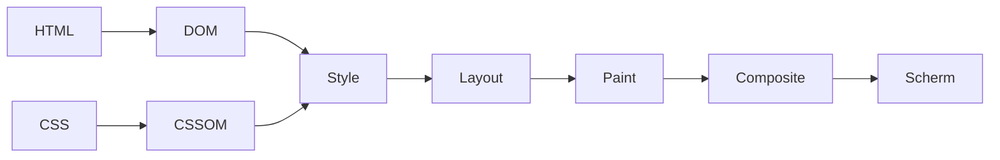
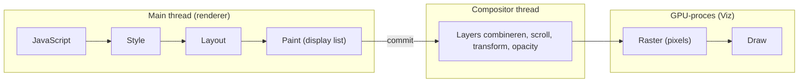
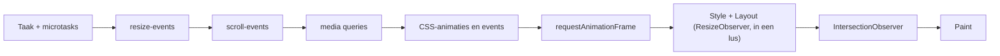

# 1. De rendering pipeline

> Wat gebeurt er tussen "DOM gewijzigd" en "pixel op scherm"?

## Kort

De browser zet HTML en CSS in vaste stappen om naar pixels: **Style → Layout → Paint → Composite**. Elke wijziging start ergens in die keten, en alles erna moet opnieuw. Hoe vroeger een wijziging instapt, hoe duurder ze is.

## Van bytes naar scherm (eerste render)



| Stap | Input | Output | Vraag die de stap beantwoordt |
|---|---|---|---|
| Parse | HTML, CSS | DOM, CSSOM | Welke elementen en regels zijn er? |
| Style | DOM + CSSOM | computed style per element | Welke CSS-waarden gelden voor elk element? |
| Layout | computed styles | layout tree met posities en maten | Waar staat elke box en hoe groot is ze? |
| Paint | layout tree | display list (tekenopdrachten) | In welke volgorde teken je wat? |
| Composite | display lists in layers | frame | Hoe leg je de layers op elkaar? |

## Paint maakt nog geen pixels

Een veelgemaakte fout: "paint" tekent niet echt. Paint maakt een lijst met tekenopdrachten (een *display list* of *paint records*). Pas bij **raster** worden die opdrachten pixels, in tiles, meestal op de GPU.

| Bron | Wat het zegt |
|---|---|
| RenderingNG | Paint maakt een display list, raster zet die om in GPU-tiles |
| Inside look at modern web browser, part 3 | De main thread maakt *paint records*, rasterizing maakt er pixels van |
| web.dev, Rendering performance | Gebruikt "paint" ruimer: het maken van draw calls én het invullen van pixels |

Dat verklaart waarom de bronnen elkaar soms lijken tegen te spreken: web.dev telt raster bij paint, Chromium niet.

## De drie paden (web.dev)

Na de eerste render hangt de kost van een wijziging af van welke CSS-property verandert.

| Pad | Stappen | Voorbeeld-properties | Kost |
|---|---|---|---|
| Layout | JS → Style → **Layout** → **Paint** → Composite | `width`, `height`, `top`, `left`, `font-size` | Hoog: posities van (mogelijk) veel boxes opnieuw |
| Paint | JS → Style → **Paint** → Composite | `color`, `background-image`, `box-shadow` | Middel: geen nieuwe posities, wel opnieuw tekenen |
| Composite | JS → Style → Composite | `transform`, `opacity` | Laag: alleen layers verschuiven of mengen |

Style loopt in alle drie de paden: de browser moet altijd eerst weten welke property veranderde.

## Wie doet wat: de threads



Waarom dit ertoe doet:

- JavaScript, Style, Layout en Paint delen **één** main thread. Een lange JS-taak blokkeert dus ook layout en paint.
- De compositor thread hoeft niet te wachten op JavaScript of style. Daarom kunnen scrollen en `transform`/`opacity`-animaties vlot blijven terwijl de main thread bezig is.
- Moet layout of paint opnieuw, dan is de main thread weer nodig, en vallen die voordelen weg.

## Eén frame in de event loop

Bij 60 Hz heeft de browser 16,7 ms per frame. web.dev rekent met ongeveer 10 ms voor je eigen werk, omdat de browser de rest nodig heeft.

Volgorde van de "update the rendering"-stappen in de HTML-spec:



- De browser mag een frame **overslaan** als een update geen zichtbaar effect heeft en er geen rAF-callbacks wachten. Rendering gebeurt dus niet "elke 16,7 ms", maar alleen als er iets te tekenen valt.
- `requestAnimationFrame` loopt net vóór style en layout. Daarom is het de juiste plek voor visuele updates.
- ResizeObserver loopt in een lus met layout: een callback die de layout wijzigt, triggert opnieuw layout in hetzelfde frame.

## Chromium in detail (RenderingNG)

Het vijfstappenmodel is een vereenvoudiging. Chromium splitst de pipeline in 12 stappen:

| # | Stap | Wat |
|---|---|---|
| 1 | Animate | Computed styles aanpassen voor animaties |
| 2 | Style | CSS toepassen op de DOM |
| 3 | Layout | Maten en posities bepalen |
| 4 | Pre-paint | Property trees berekenen (transform, clip, effect, scroll) |
| 5 | Scroll | Scroll offset van containers bijwerken |
| 6 | Paint | Display list maken |
| 7 | Commit | Property trees en display list naar de compositor kopiëren |
| 8 | Layerize | Display list opdelen in layers die apart gerasterd en geanimeerd kunnen worden |
| 9 | Raster, decode, paint worklets | Display lists omzetten in GPU-tiles |
| 10 | Activate | Een nieuw compositor frame klaarzetten |
| 11 | Aggregate | Frames van alle bronnen (tabs, iframes, browser-UI) samenvoegen |
| 12 | Draw | Het frame op het scherm zetten |

Animate en Scroll kunnen zowel op de main thread als op de compositor lopen. Style tot en met Commit loopt op de main thread. Raster en Draw gebeuren in het Viz-proces (GPU).

## Zelf zien

Een box die op drie manieren verandert. Neem een trace op in DevTools (Performance) en klik elke knop.

```html
<style>
  #box { width: 100px; height: 100px; background: teal; will-change: transform; }
  #box.wide  { width: 200px; }                  /* layout-pad */
  #box.red   { background: tomato; }            /* paint-pad */
  #box.moved { transform: translateX(100px); }  /* composite-pad */
</style>
<div id="box"></div>
<button onclick="box.classList.toggle('wide')">width</button>
<button onclick="box.classList.toggle('red')">kleur</button>
<button onclick="box.classList.toggle('moved')">transform</button>
```

Verwachting (nog te controleren in de trace):

| Knop | Recalculate Style | Layout | Paint |
|---|---|---|---|
| width | ja | ja | ja |
| kleur | ja | nee | ja |
| transform | ja | nee | nee |

`will-change: transform` geeft de box vooraf een eigen layer. Zonder die regel kan de eerste `transform` toch een paint geven, omdat de browser dan pas een layer aanmaakt.

## Open vragen

- Welke event-namen toont de huidige Chrome-versie in een trace (bv. `Pre-Paint`, `Layerize`, `Commit`)? Die verschillen per versie.
- Klopt de verwachting van de demo, ook zonder `will-change`?
- Hoe verschillen Firefox (WebRender) en Safari (WebKit) van dit Chromium-model?

## Bronnen

- [RenderingNG architecture](https://developer.chrome.com/docs/chromium/renderingng-architecture) (Chromium): de 12 stappen en de threads
- [Rendering performance](https://web.dev/articles/rendering-performance) (web.dev): de pixel pipeline en de drie paden
- [Inside look at modern web browser, part 3](https://developer.chrome.com/blog/inside-browser-part3) (Chrome, 2018): van parsing tot compositing
- [Update the rendering](https://html.spec.whatwg.org/multipage/webappapis.html#update-the-rendering) (HTML-spec): volgorde binnen een frame
